# H3 Cyber Lab

## 1) Read and Summarize

### Heinonen 2026: How to Install Linux to Virtualbox?

This article was useful to me, but since I had already installed VirtualBox and Debian before reading it, I could only compare my own experience with the steps described in the article.

Overall, my installation process was very similar. I updated my existing VirtualBox installation, downloaded the Debian 13.7 Live Xfce ISO, created a new virtual machine, configured its resources, disabled unattended installation, and installed Debian using the graphical Calamares installer.

However, there were a few differences:

- I allocated 3 GB of RAM instead of the recommended 4 GB because my host computer has only 16 GB, and I wanted to avoid allocating too much memory to the virtual machine.
- I had to enable AMD-V in my computer's BIOS because it was disabled. The article mentions this requirement, but in my case, it was an actual problem that prevented the virtual machine from starting.
- I also installed VirtualBox Guest Additions to enable the shared clipboard between Windows and Debian. This step was not covered in the article, and I encountered some additional problems during the installation, as described in section 3).

My main takeaway is that installing Linux in a virtual machine is quite straightforward, but hardware settings and integration between the host and guest systems can require additional troubleshooting.

### Karvinen 2020: Command Line Basics Revisited

I read the article, but since I have worked with the Unix/Linux command line before, most of the commands were already familiar to me.

A few personal observations:

- I also prefer `less` over `more` because it allows scrolling both forward and backward through the output and searching for specific text.
- I am used to working with `vim` as my text editor, so I prefer it over `nano`.
- I have already used `sudo` when updating packages and installing VirtualBox Guest Additions in my Debian VM.

The article also emphasizes the principle of least privilege, which I consider especially important in cybersecurity. Administrative privileges should only be used when necessary.

### Karvinen 2022: Cracking Passwords with Hashcat

The article explains how password hashes can be attacked using Hashcat and a dictionary of commonly used passwords.

My main observations:

- Hashing is a one-way operation. Instead of reversing a hash, Hashcat calculates hashes from password candidates and compares them with the target.
- Hashcat needs to know which hashing algorithm is being used. The `hashid` utility can suggest possible algorithms based on the hash format.
- A dictionary attack uses a list of possible passwords. The RockYou dictionary contains more than 14 million passwords collected from a historical data breach.
- Hashcat can use GPUs to accelerate password cracking, although the experiment can also be performed on a CPU.
- The success of a dictionary attack depends on whether the correct password, or a matching candidate, is present in the dictionary.

I found it interesting how a seemingly unreadable hash can still be vulnerable when the original password is simple and the hashing algorithm is fast.

This also made me think about the importance of modern password hashing algorithms, such as Argon2id, which are specifically designed to make password guessing more computationally expensive.

The article also emphasizes that password cracking tools must only be used in authorized environments. In this exercise, I worked with the example hash provided by the teacher.

---

## 2) Presentation Title

I reserved my presentation title in Laksu:

**The Evolution of Web Authentication**

- Date: 25 November 2026 (Wednesday)
- Week: 48

The presentation will cover how web authentication has evolved, from traditional passwords and password hashing to multi-factor authentication and modern passwordless solutions.

---

## 3) Linux — Debian 13 Installation

I installed Debian 13 during the voluntary bonus task H2(e), before starting H3. I decided to keep the existing installation rather than create another virtual machine.

The installation was done earlier, so I did not prepare installation screenshots for this report. However, I documented the configuration, problems I encountered, their solutions, and the commands used to verify the installation.

### Host computer

- OS: Windows 10 Pro 22H2
- CPU: AMD FX-8320
- RAM: 16 GB
- Motherboard: Gigabyte GA-78LMT-USB3 R2
- Virtualization software: Oracle VirtualBox

### Virtual machine configuration

I downloaded Debian 13.7 (Trixie) Live Xfce amd64 from the official Debian website.

I created a new virtual machine with the following settings:

- Name: Debian13-CyberLab
- OS type: Debian (64-bit)
- RAM: 3072 MB
- CPUs: 2
- Virtual disk: 30 GB, dynamically allocated VDI
- Network: NAT
- Graphics controller: VMSVGA
- Video memory: 128 MB
- EFI: Enabled

I disabled unattended installation and used the graphical installer.

### Installation process

1. Created a new virtual machine in VirtualBox.
2. Attached the Debian Live Xfce ISO.
3. Started the live environment.
4. Opened the graphical Debian installer (Calamares).
5. Selected the virtual 30 GB disk and used automatic partitioning.
6. Created a user account and completed the installation.
7. Rebooted into the installed Debian system.

### System updates and preparation

After installing Debian, I updated the package lists and started upgrading the installed packages:

```bash
sudo apt update
sudo apt full-upgrade -y
```

Before installing VirtualBox Guest Additions, I also ran:

```bash
sudo apt install -y build-essential dkms linux-headers-$(uname -r)
```

These packages provide the tools and kernel headers needed to build additional kernel modules.

I initially tried installing Guest Additions from the Debian repositories, but the suggested VirtualBox guest packages were not available in my configured repositories. I therefore switched to the Guest Additions ISO provided by VirtualBox.

### Problems and solutions

**1. Hardware virtualization was disabled**

When I first tried to start the virtual machine, VirtualBox displayed:

`AMD-V is disabled in the BIOS (VERR_SVM_DISABLED)`

The CPU supports AMD-V, but virtualization was disabled in the BIOS.

**Solution:** I restarted the computer, entered the BIOS, found the virtualization setting under Advanced BIOS Features, enabled it, and saved the changes.

After that, Debian Live started successfully.

**2. Guest Additions installation**

After installing Debian, the shared clipboard between Windows and Debian did not work.

I tried to install the VirtualBox guest packages through APT, but the suggested packages were not available from the configured repositories.

I then used the Guest Additions ISO provided by VirtualBox.

Initially, VirtualBox reported:

`VERR_PDM_MEDIA_LOCKED`

The virtual optical drive was still occupied by the Debian installation ISO.

**Solution:** I unmounted and removed the Debian ISO and attached the VirtualBox Guest Additions image instead.

I also had to create a mount directory before mounting the CD:

```bash
sudo mkdir -p /mnt/vbox
sudo mount /dev/sr0 /mnt/vbox
```

After mounting the correct image, I ran the Guest Additions installer:

```bash
sudo sh /mnt/vbox/VBoxLinuxAdditions.run
```

After rebooting Debian and enabling **Devices → Shared Clipboard → Bidirectional**, copying text between Windows and Debian worked correctly.

### Installation verification

I verified the installed system using the following commands:

```bash
cat /etc/os-release
uname -a
systemd-detect-virt
lsblk -o NAME,SIZE,TYPE,MOUNTPOINTS
```

Relevant output:

```text
PRETTY_NAME="Debian GNU/Linux 13 (trixie)"
VERSION_ID="13"
DEBIAN_VERSION_FULL=13.7

Linux anna-virtualbox 6.12.115+deb13.1-amd64 #1 SMP PREEMPT_DYNAMIC Debian 6.12.115-2 (2026-11-01) x86_64 GNU/Linux

$ systemd-detect-virt
oracle

$ lsblk -o NAME,SIZE,TYPE,MOUNTPOINTS
NAME    SIZE TYPE MOUNTPOINTS
sda      30G disk
├─sda1  300M part /boot/efi
├─sda2 23.3G part /
└─sda3  6.4G part [SWAP]
sr0    50.7M rom
```

### Result

Debian 13.7 with Xfce was successfully installed in Oracle VirtualBox.

Hardware virtualization works, the system boots normally, and Guest Additions provide shared clipboard functionality.

The virtual machine is ready for the next cybersecurity lab exercises.

---

## 4) Crack — Hashcat

### Objective and environment

The objective was to crack the example hash provided in the assignment:

`6b1628b016dff46e6fa35684be6acc96`

I followed the instructions from Karvinen's article *Cracking Passwords with Hashcat*.

The experiment was performed in my Debian 13.7 virtual machine running in Oracle VirtualBox, as described in section 3).

### Installing the required tools

First, I updated the package lists and installed Hashcat, Hashid and Wget:

```bash
sudo apt-get update
sudo apt-get -y install hashid hashcat wget
```

I verified that the commands were available:

```bash
which hashid hashcat wget
```

Output:

```text
/usr/bin/hashid
/usr/bin/hashcat
/usr/bin/wget
```

All three tools were available.


### Preparing the working directory

I created a separate directory for the exercise:

```bash
cd ~
mkdir hashed
cd hashed
```


Before continuing, I also installed `vim`, since I prefer it over `nano`.

```bash
sudo apt install vim
```

I configured two aliases directly in my `~/.bashrc` file:

```bash
alias ll='ls -la'
alias vi='vim'
```

This allowed me to use `ll` for detailed directory listings and `vi` to launch Vim.

### Downloading the RockYou dictionary

I downloaded the RockYou password dictionary using the URL provided in the article:

```bash
wget https://github.com/danielmiessler/SecLists/raw/master/Passwords/Leaked-Databases/rockyou.txt.tar.gz
```

I checked that the archive had been downloaded:

```bash
ll
```

The downloaded archive was approximately 53 MB.


Next, I extracted the archive:

```bash
tar xvfz rockyou.txt.tar.gz
```

I checked the directory again using `ll`. The extracted `rockyou.txt` file was approximately 140 MB.


I examined the beginning of the dictionary:

```bash
head rockyou.txt
```

The first entries included:

```text
123456
12345
123456789
password
iloveyou
princess
1234567
rockyou
12345678
abc123
```


Then I counted the number of lines:

```bash
cat rockyou.txt | wc -l
```

Output:

```text
14344391
```

The dictionary contained 14,344,391 password candidates, matching the number mentioned in the article.


### Customizing the Bash prompt

After checking the contents of `rockyou.txt`, I decided to customize the Bash prompt to make it look more familiar to me.

I modified the `PS1` configuration in `~/.bashrc` to display the full current directory path instead of `~`, and added the current time in `HH:MM:SS` format.

I kept the colored username, hostname and directory path.

As a result, the terminal prompt looks different in the following screenshots.

### Identifying the hash type

Before attempting to crack the hash, I used `hashid` to identify possible hashing algorithms:

```bash
hashid -m 6b1628b016dff46e6fa35684be6acc96
```

The output included several possibilities:

```text
[+] MD2
[+] MD5 [Hashcat Mode: 0]
[+] MD4 [Hashcat Mode: 900]
[+] Double MD5 [Hashcat Mode: 2600]
```

The utility also listed other possible formats.


The hash format alone does not uniquely identify the algorithm, but MD5 was one of the suggested candidates.

Following the article, I selected MD5, which corresponds to Hashcat mode `0`.

### Cracking the hash

I started the dictionary attack with the following command:

```bash
hashcat -m 0 '6b1628b016dff46e6fa35684be6acc96' rockyou.txt -o solved
```

The parameters mean:

- `-m 0` — use MD5.
- `6b1628b016dff46e6fa35684be6acc96` — the target hash.
- `rockyou.txt` — the dictionary containing password candidates.
- `-o solved` — save the recovered password to a file named `solved`.

Hashcat version 6.2.6 started successfully.


### Monitoring system resource usage

While Hashcat was running, I became curious about how much system resources it was using, so I opened another terminal and ran:

```bash
top
```

I noticed that the Hashcat process was using approximately 100% of one logical CPU and 21.3% of the VM's RAM (around 630 MiB).

Since the virtual machine had two virtual CPUs, this represented approximately half of its total available CPU capacity.

This was interesting because it showed how computationally intensive password cracking can be, even when using a dictionary attack.


### Hashcat results

Hashcat completed successfully and reported that the password had been recovered.

Relevant output:

```text
Session..........: hashcat
Status...........: Cracked
Hash.Mode........: 0 (MD5)
Hash.Target......: 6b1628b016dff46e6fa35684be6acc96
Kernel.Feature...: Pure Kernel
Guess.Base.......: File (rockyou.txt)
Guess.Queue......: 1/1 (100.00%)
Speed.#1.........: 4573 H/s (0.11ms)
Recovered........: 1/1 (100.00%) Digests
Progress.........: 512/14344384 (0.00%)
Hardware.Mon.#1..: Util: 53%
```


The reported speed was approximately 4,573 hashes per second.

The attack was performed using the CPU in the virtual machine, without GPU acceleration.

The result also showed that only a small fraction of the dictionary needed to be tested before the correct password was found.

### Verifying the recovered password

Finally, I checked the output file created by Hashcat:

```bash
cat solved
```

Output:

```text
6b1628b016dff46e6fa35684be6acc96:summer
```


The recovered password was:

**summer**

This matched the expected result from the article.

### Conclusions

The exercise was completed successfully. I installed the required tools, downloaded and checked the RockYou dictionary, identified MD5 as a possible hash type, and recovered the password using Hashcat.

A few observations:

- Hashcat was able to recover the password using a dictionary attack without requiring GPU acceleration.
- The password `summer` was found after testing only a small number of candidates from a dictionary containing over 14 million entries.
- During the attack, Hashcat used approximately one full virtual CPU core and around 21% of the VM's memory.
- The experiment demonstrated that fast hashing algorithms such as MD5 are unsuitable for secure password storage, especially when users choose common passwords.

I did not encounter any errors during the actual Hashcat experiment. The additional steps I performed were related to customizing my working environment and monitoring system resource usage.

The most important lesson for me was the practical difference between hashing and password security. Although a hash cannot simply be reversed, an attacker can still recover a weak password by hashing likely candidates and comparing the results.


## 5) Voluntary Bonus — John the Ripper Jumbo

Before starting this exercise, I slightly customized my Bash prompt again to make it more convenient. I shortened the displayed hostname to `vm`, while keeping the full directory path and current time. This explains why the prompt looks a little different in the following screenshots.

For this exercise, I followed the tutorial [Crack File Password With John](https://terokarvinen.com/2023/crack-file-password-with-john/) by Tero Karvinen (2023).

The objective was to install John the Ripper Jumbo, extract a password hash from an encrypted ZIP archive, and recover the password.

### Installing dependencies

I started by installing the dependencies required to build John the Ripper Jumbo from source:

```bash
sudo apt install -y git build-essential libssl-dev zlib1g-dev libbz2-dev atool zip unzip wget pkg-config
```

I did not run `apt update` again because I had already updated the package lists earlier during the Hashcat exercise.

Some packages, including `build-essential`, `unzip`, and `wget`, were already installed.

APT reported that 15 additional packages would be installed.

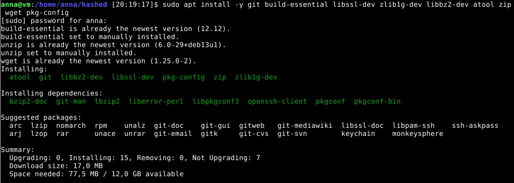

The installation completed successfully without errors.

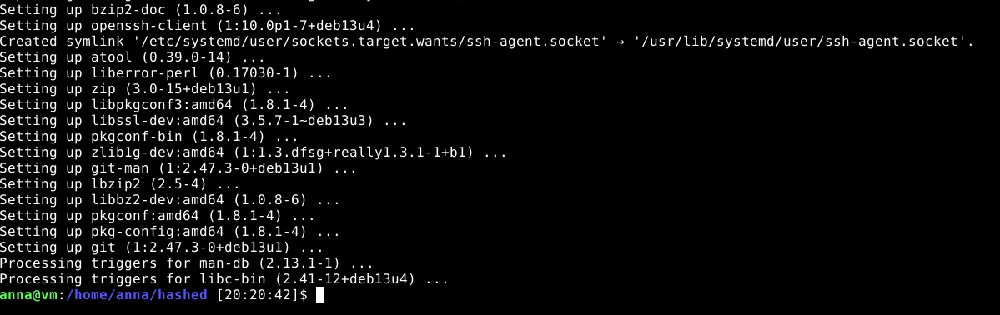

### Downloading John the Ripper Jumbo

I downloaded the source code from the official Openwall GitHub repository:

```bash
cd ~
git clone https://github.com/openwall/john.git
```

The repository was cloned successfully.

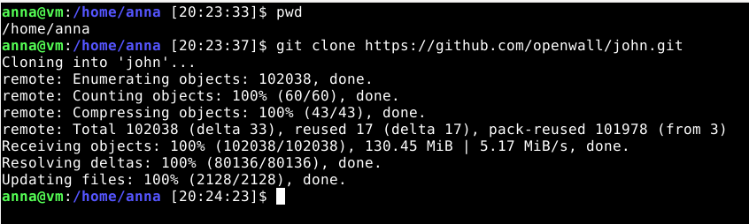

I entered the project directory and checked its status:

```bash
cd ~/john
git status
ll
```

Git reported that the current branch was `bleeding-jumbo` and the working tree was clean.

The repository contained the expected `src` and `run` directories.

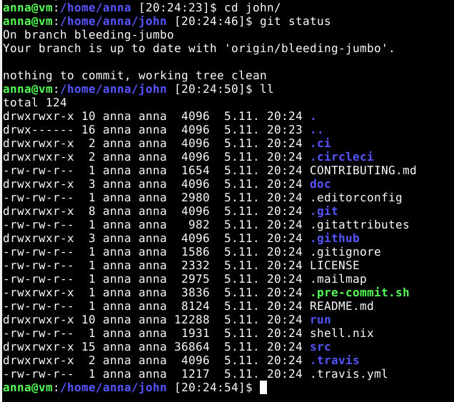

### Compiling John the Ripper Jumbo

I changed to the source directory and ran the configuration script:

```bash
cd ~/john/src
./configure
```

The script checked the compiler, libraries, and available CPU features.

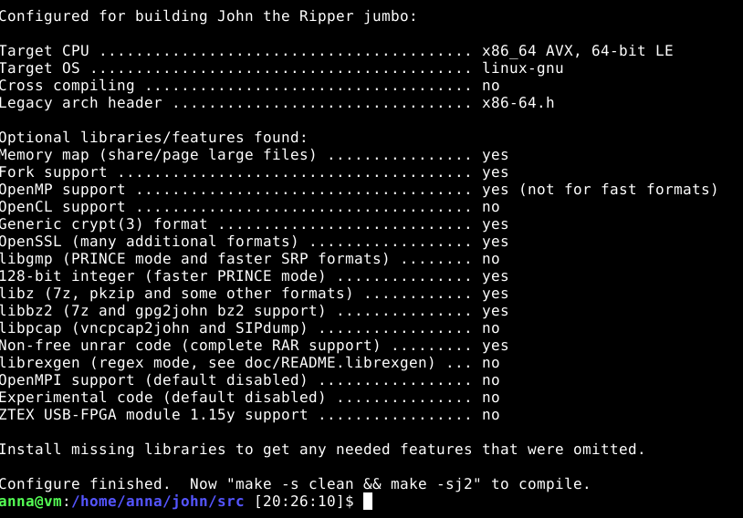

After configuration, I compiled the program:

```bash
make -j2
```

I used `-j2` because my Debian virtual machine has two virtual CPUs.

The compilation completed successfully:

```text
Make process completed.
```

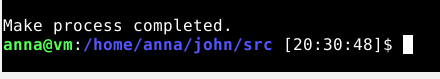

To verify the installation, I ran:

```bash
cd ~/john/run
./john --list=build-info
```

The output included:

```text
Version: 1.9.0-jumbo-1+bleeding
Build: linux-gnu 64-bit x86_64 AVX AC OMP
SIMD: AVX
AES hardware acceleration: AES-NI
```

This confirmed that John the Ripper Jumbo was compiled and could run on my system.

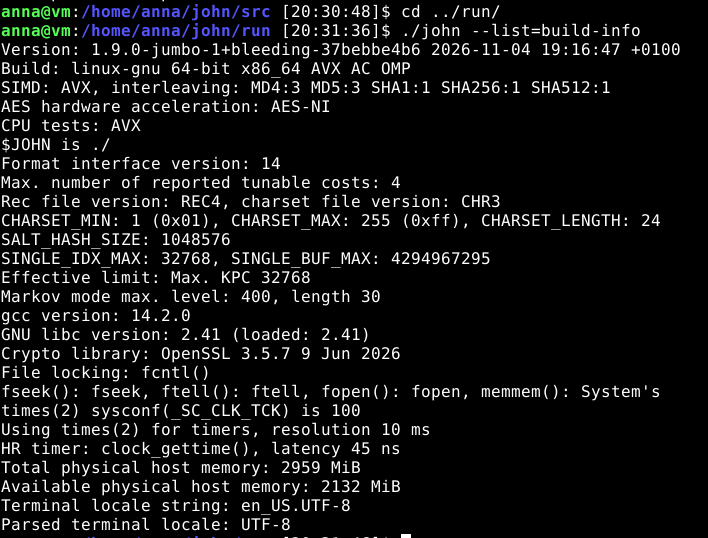

### Downloading and testing the encrypted ZIP

I created a separate working directory:

```bash
mkdir -p ~/john-lab
cd ~/john-lab
```

Then I downloaded the example ZIP archive provided in the article:

```bash
wget https://terokarvinen.com/2023/crack-file-password-with-john/tero.zip
```

The archive was downloaded successfully and had a size of 543 bytes.

I tried extracting it:

```bash
unzip tero.zip
```

The archive requested a password for `secretFiles/SECRET.md`.

I entered an incorrect password, and the extraction failed:

```text
skipping: secretFiles/SECRET.md incorrect password
```

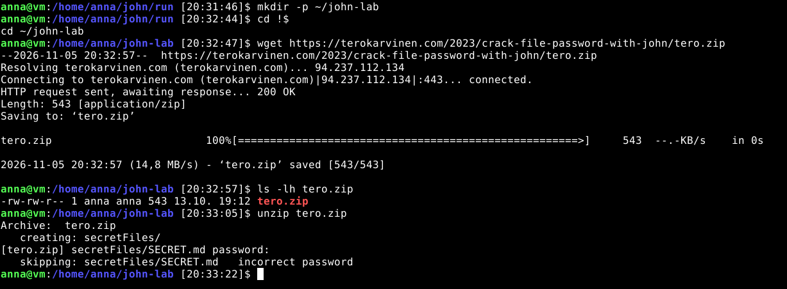

This confirmed that the file inside the ZIP archive was protected by a password.

### Extracting the ZIP hash

Next, I used `zip2john` to extract the information required for password cracking:

```bash
~/john/run/zip2john tero.zip > tero.hash
```

I checked the resulting file:

```bash
ll tero.hash
head tero.hash
```

The file was 494 bytes and contained a hash in the `$pkzip$` format.

The tool also reported that the directory entry `secretFiles/` was not encrypted. This was normal because the actual protected content was the file `SECRET.md`.

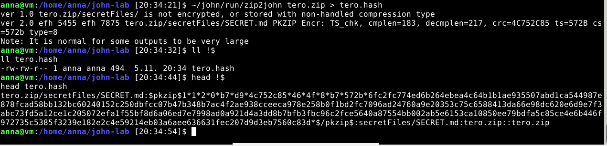

### Cracking the ZIP password

I started John the Ripper:

```bash
~/john/run/john tero.hash
```

John recognized the PKZIP format and used two OpenMP threads.

The password was recovered almost immediately:

```text
butterfly        (tero.zip/secretFiles/SECRET.md)
Session completed
```

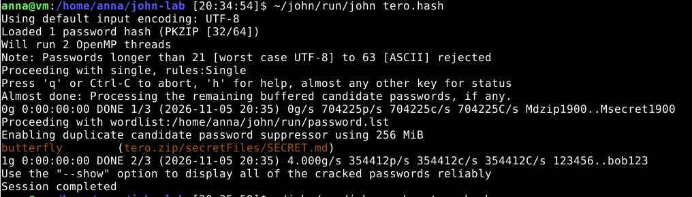

I verified the result:

```bash
~/john/run/john --show tero.hash
```

The output confirmed:

```text
1 password hash cracked, 0 left
```

The recovered password was `butterfly`.

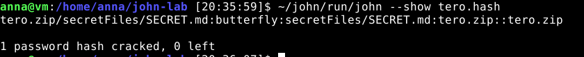

### Verifying the password by extracting the archive

Finally, I tested the recovered password against the actual ZIP archive:

```bash
unzip tero.zip
```

When prompted, I entered `butterfly`.

The archive was extracted successfully.

I checked the extracted file:

```bash
ll secretFiles/
cat secretFiles/SECRET.md
```

The file contained:

```text
You've found the secret, well done!

You have now completed the tutorial.
```

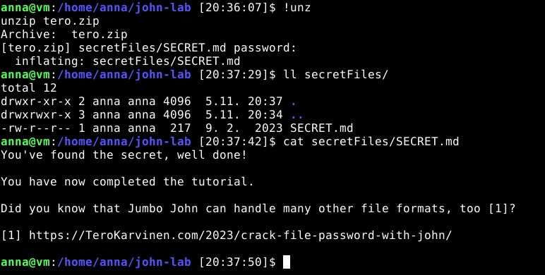

### Conclusion

I successfully installed John the Ripper Jumbo from source, extracted a PKZIP hash, recovered the password, and verified it by opening the encrypted archive.

The exercise demonstrated how John the Ripper can recover passwords from encrypted archives after extracting the required hash data with tools such as `zip2john`.

I did not encounter any major problems during the installation, compilation, or ZIP cracking process.

---

## 6) Voluntary Bonus — The Other John

For this bonus exercise, I continued using John the Ripper Jumbo installed in the previous task.

The objective was to create my own encrypted file in a format other than ZIP and attempt to recover its password.

I decided to use a **7z archive**, which supports AES-256 encryption.

Unlike the previous exercise, I used my own password containing uppercase letters, lowercase letters, and numbers. It was not a dictionary word.

### Checking 7-Zip installation

I started by checking whether 7-Zip was installed:

```bash
sudo apt install -y 7zip
```

APT reported that the package was already installed.

I checked the version:

```bash
7z | head -n 5
```

The output showed:

```text
7-Zip 25.01 (x64)
```

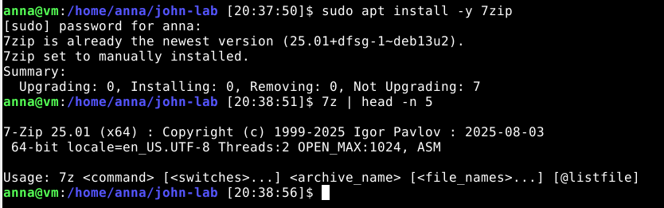

### Creating an encrypted 7z archive

I created a separate working directory:

```bash
mkdir -p ~/john-lab/7z-test
cd ~/john-lab/7z-test
```

I created a small text file named `secretfile`.

My first attempt to create an encrypted archive used:

```bash
7z a -t7z -mhe=on secret.7z secretfile
```

However, 7-Zip did not request a password.

I realized that `-mhe=on` controls header encryption, but does not enable password protection on its own. I needed to add the `-p` option.

I deleted the archive and corrected the command:

```bash
rm secret.7z
7z a -t7z -mhe=on -p secret.7z secretfile
```

This time 7-Zip requested a password, and the archive was created successfully:

```text
Everything is Ok
```

To verify the protection, I tried listing the archive contents:

```bash
7z l secret.7z
```

I entered an incorrect password, and 7-Zip displayed:

```text
ERROR: secret.7z : Cannot open encrypted archive. Wrong password?
Headers Error
```

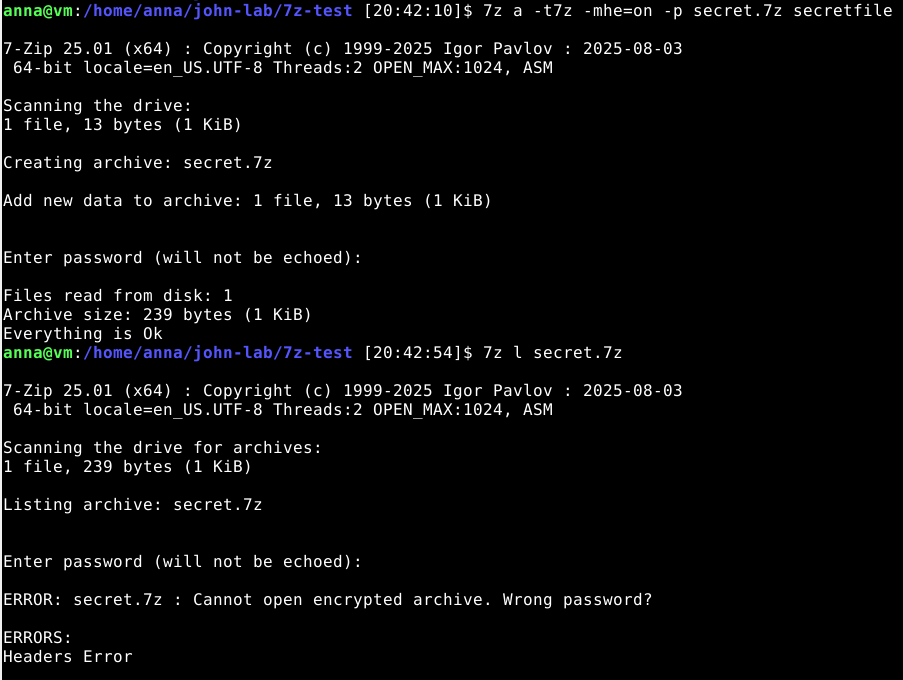

This confirmed that the archive was encrypted and that its contents could not be listed without the correct password.

### Extracting the 7z hash

I checked whether the `7z2john.pl` utility was available:

```bash
ls -l ~/john/run/7z2john.pl
```

Then I attempted to extract the hash:

```bash
perl ~/john/run/7z2john.pl secret.7z > secret.hash
```

However, the command failed:

```text
Can't locate Compress/Raw/Lzma.pm in @INC
BEGIN failed--compilation aborted
```

The required Perl module `Compress::Raw::Lzma` was missing.

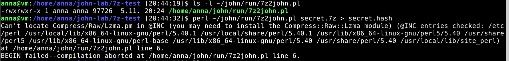

### Fixing the missing Perl module

I installed the missing dependency:

```bash
sudo apt install -y libcompress-raw-lzma-perl
```

Then I repeated the hash extraction:

```bash
perl ~/john/run/7z2john.pl secret.7z > secret.hash
```

This time the command completed successfully.

I checked the output:

```bash
ll secret.hash
head secret.hash
```

The resulting file was 334 bytes and contained data beginning with the `$7z$` marker.

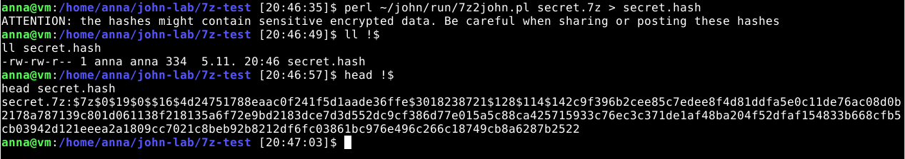

The utility also displayed a warning that extracted hashes may contain sensitive encrypted data.

Since I was using my own test file, this did not create a confidentiality issue, but it was a useful reminder that hashes extracted from real encrypted documents should be handled carefully.

### Attempting to crack the password

I started John the Ripper using the extracted hash:

```bash
~/john/run/john secret.hash
```

Unlike the previous ZIP exercise, John did not recover the password immediately.

I wanted to see how much CPU and memory the process was using, so I opened another terminal and ran:

```bash
top
```

John was using approximately 179% CPU, meaning it was utilizing almost both virtual CPU cores.

Its memory usage was only around 1.9% of the VM's RAM, approximately 57 MiB.

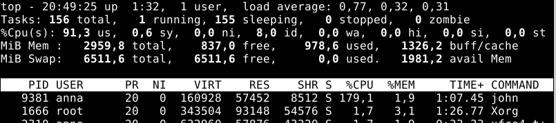

The password cracking speed was surprisingly slow, approximately **7–8 candidates per second**.

This is because 7z uses a computationally expensive key derivation process based on repeated SHA-256 calculations. For each password candidate, John has to derive an encryption key and test it against the encrypted archive.

This makes password guessing much slower than testing a simple MD5 hash.

### Stopping the unsuccessful cracking attempt

I allowed John to continue for approximately 7.5 minutes.

During this time, it reached about 37% of its first cracking stage, but did not recover the password.

The speed remained around 7.4 passwords per second.

Since my password was not a dictionary word and included uppercase and lowercase letters and numbers, I decided not to continue waiting for an unknown amount of time.

I stopped John manually.

The output ended with:

```text
Session aborted
```

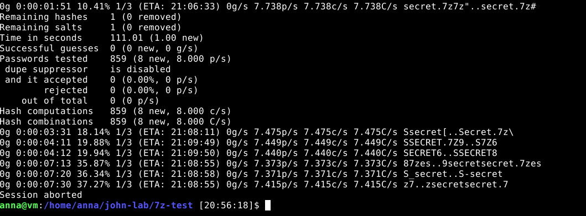

The reported progress referred only to the first cracking stage, not to the entire password search space.

### Conclusion

Although John the Ripper successfully extracted the hash from my encrypted 7z archive, it did not recover the password during the time I allowed it to run.

My main observations were:

- Password cracking speed depends heavily on the encryption and key derivation methods used.
- The 7z archive was considerably more computationally expensive to attack than the MD5 hash used in H3(c).
- John used almost both virtual CPU cores while testing only around 7–8 password candidates per second.
- A password that is not present among the generated candidates may require much more time and a different attack strategy.
- Successfully extracting a hash does not guarantee that the original password can be recovered within a practical amount of time.

I deliberately stopped the experiment rather than continue an open-ended brute-force attempt.

This was an interesting contrast with the previous exercises, where Hashcat quickly recovered `summer` from an MD5 hash and John the Ripper recovered `butterfly` from the provided ZIP archive.

The experiment helped me better understand why the choice of encryption format, password complexity, and computational cost are important for protecting encrypted data.

---


## References

1. Heinonen, J. (2026). [How to Install Linux to Virtualbox?](https://github.com/johannaheinonen/johanna-test-repo/blob/main/module_1.md).
2. Karvinen, T. (2020). [Command Line Basics Revisited](https://terokarvinen.com/2020/command-line-basics-revisited/).
3. Karvinen, T. (2022). [Cracking Passwords with Hashcat](https://terokarvinen.com/2022/cracking-passwords-with-hashcat/).
4. [Hashcat — Official Website](https://hashcat.net/hashcat/).
5. [SecLists — GitHub Repository](https://github.com/danielmiessler/SecLists).
6. Karvinen, T. (2023). [Crack File Password With John](https://terokarvinen.com/2023/crack-file-password-with-john/).
