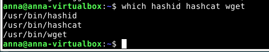
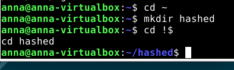
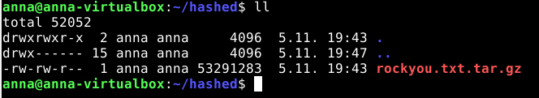
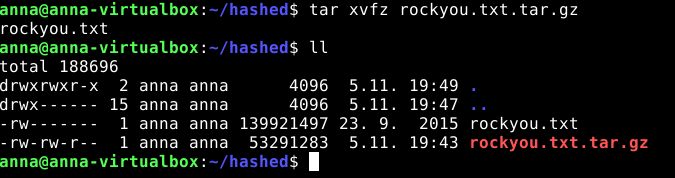
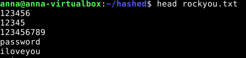
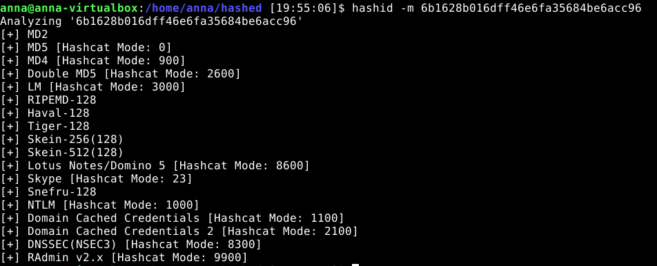
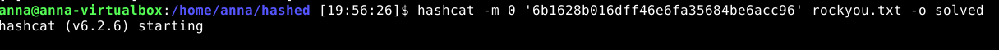
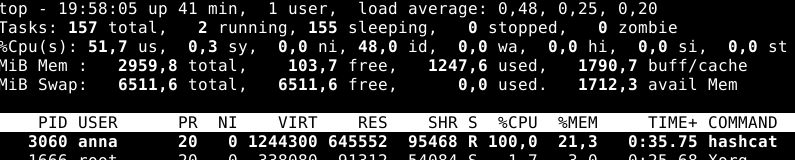
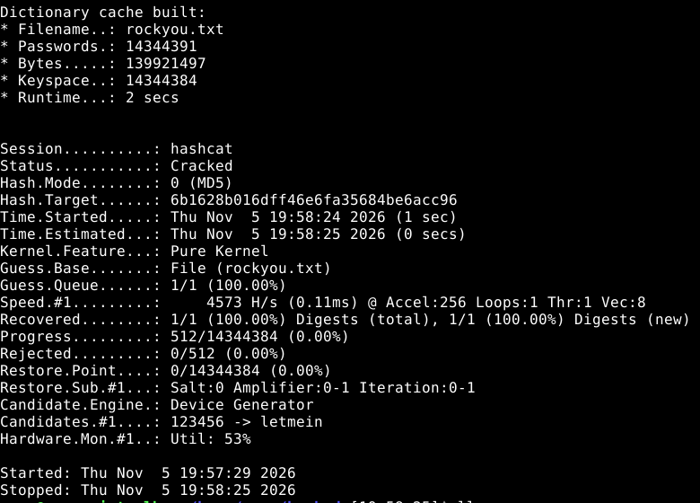
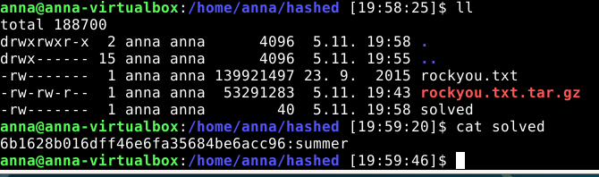

# H3 Cyber Lab

## 1) Read and Summarize

### Heinonen 2026: How to Install Linux to Virtualbox?

This article was useful to me, but since I had already installed VirtualBox and Debian before reading it, I could only compare my own experience with the steps described in the article.

Overall, my installation process was very similar. I updated my existing VirtualBox installation, downloaded the Debian 13.7 Live Xfce ISO, created a new virtual machine, configured its resources, disabled unattended installation, and installed Debian using the graphical Calamares installer.

However, there were a few differences:

- I allocated 3 GB of RAM instead of the recommended 4 GB because my host computer has only 16 GB, and I wanted to avoid allocating too much memory to the virtual machine.
- I had to enable AMD-V in my computer's BIOS because it was disabled. The article mentions this requirement, but in my case, it was an actual problem that prevented the virtual machine from starting.
- I also installed VirtualBox Guest Additions to enable the shared clipboard between Windows and Debian. This step was not covered in the article, and I encountered some additional problems during the installation, as described in section b).

My main takeaway is that installing Linux in a virtual machine is quite straightforward, but hardware settings and integration between the host and guest systems can require additional troubleshooting.

### Karvinen 2020: Command Line Basics Revisited

I read the article, but since I have worked with the Unix/Linux command line before, most of the commands were already familiar to me.

A few personal observations:

- I also prefer `less` over `more` because it allows scrolling both forward and backward through the output and searching for specific text.
- I am used to working with `vim` as my text editor, so I prefer it over `nano`.
- I have already used `sudo` when updating packages and installing VirtualBox Guest Additions in my Debian VM.

The article also emphasizes the principle of least privilege, which I consider especially important in cybersecurity. Administrative privileges should only be used when necessary.

### Karvinen 2022: Cracking Passwords with Hashcat

The article explains how password hashes can be attacked using Hashcat and a dictionary of commonly used passwords.

My main observations:

- Hashing is a one-way operation. Instead of reversing a hash, Hashcat calculates hashes from password candidates and compares them with the target.
- Hashcat needs to know which hashing algorithm is being used. The `hashid` utility can suggest possible algorithms based on the hash format.
- A dictionary attack uses a list of possible passwords. The RockYou dictionary contains more than 14 million passwords collected from a historical data breach.
- Hashcat can use GPUs to accelerate password cracking, although the experiment can also be performed on a CPU.
- The success of a dictionary attack depends on whether the correct password, or a matching candidate, is present in the dictionary.

I found it interesting how a seemingly unreadable hash can still be vulnerable when the original password is simple and the hashing algorithm is fast.

This also made me think about the importance of modern password hashing algorithms, such as Argon2id, which are specifically designed to make password guessing more computationally expensive.

The article also emphasizes that password cracking tools must only be used in authorized environments. In this exercise, I worked with the example hash provided by the teacher.

---

## 2) Presentation Title

I reserved my presentation title in Laksu:

**The Evolution of Web Authentication**

- Date: 25 November 2026 (Wednesday)
- Week: 48

The presentation will cover how web authentication has evolved, from traditional passwords and password hashing to multi-factor authentication and modern passwordless solutions.

---

## 3) Linux — Debian 13 Installation

I installed Debian 13 during the voluntary bonus task H2(e), before starting H3. I decided to keep the existing installation rather than create another virtual machine.

The installation was done earlier, so I did not prepare installation screenshots for this report. However, I documented the configuration, problems I encountered, their solutions, and the commands used to verify the installation.

### Host computer

- OS: Windows 10 Pro 22H2
- CPU: AMD FX-8320
- RAM: 16 GB
- Motherboard: Gigabyte GA-78LMT-USB3 R2
- Virtualization software: Oracle VirtualBox

### Virtual machine configuration

I downloaded Debian 13.7 (Trixie) Live Xfce amd64 from the official Debian website.

I created a new virtual machine with the following settings:

- Name: Debian13-CyberLab
- OS type: Debian (64-bit)
- RAM: 3072 MB
- CPUs: 2
- Virtual disk: 30 GB, dynamically allocated VDI
- Network: NAT
- Graphics controller: VMSVGA
- Video memory: 128 MB
- EFI: Enabled

I disabled unattended installation and used the graphical installer.

### Installation process

1. Created a new virtual machine in VirtualBox.
2. Attached the Debian Live Xfce ISO.
3. Started the live environment.
4. Opened the graphical Debian installer (Calamares).
5. Selected the virtual 30 GB disk and used automatic partitioning.
6. Created a user account and completed the installation.
7. Rebooted into the installed Debian system.

### System updates and preparation

After installing Debian, I updated the package lists and started upgrading the installed packages:

```bash
sudo apt update
sudo apt full-upgrade -y
```

Before installing VirtualBox Guest Additions, I also ran:

```bash
sudo apt install -y build-essential dkms linux-headers-$(uname -r)
```

These packages provide the tools and kernel headers needed to build additional kernel modules.

I initially tried installing Guest Additions from the Debian repositories, but the suggested VirtualBox guest packages were not available in my configured repositories. I therefore switched to the Guest Additions ISO provided by VirtualBox.

### Problems and solutions

**1. Hardware virtualization was disabled**

When I first tried to start the virtual machine, VirtualBox displayed:

`AMD-V is disabled in the BIOS (VERR_SVM_DISABLED)`

The CPU supports AMD-V, but virtualization was disabled in the BIOS.

**Solution:** I restarted the computer, entered the BIOS, found the virtualization setting under Advanced BIOS Features, enabled it, and saved the changes.

After that, Debian Live started successfully.

**2. Guest Additions installation**

After installing Debian, the shared clipboard between Windows and Debian did not work.

I tried to install the VirtualBox guest packages through APT, but the suggested packages were not available from the configured repositories.

I then used the Guest Additions ISO provided by VirtualBox.

Initially, VirtualBox reported:

`VERR_PDM_MEDIA_LOCKED`

The virtual optical drive was still occupied by the Debian installation ISO.

**Solution:** I unmounted and removed the Debian ISO and attached the VirtualBox Guest Additions image instead.

I also had to create a mount directory before mounting the CD:

```bash
sudo mkdir -p /mnt/vbox
sudo mount /dev/sr0 /mnt/vbox
```

After mounting the correct image, I ran the Guest Additions installer:

```bash
sudo sh /mnt/vbox/VBoxLinuxAdditions.run
```

After rebooting Debian and enabling **Devices → Shared Clipboard → Bidirectional**, copying text between Windows and Debian worked correctly.

### Installation verification

I verified the installed system using the following commands:

```bash
cat /etc/os-release
uname -a
systemd-detect-virt
lsblk -o NAME,SIZE,TYPE,MOUNTPOINTS
```

Relevant output:

```text
PRETTY_NAME="Debian GNU/Linux 13 (trixie)"
VERSION_ID="13"
DEBIAN_VERSION_FULL=13.7

Linux anna-virtualbox 6.12.115+deb13.1-amd64 #1 SMP PREEMPT_DYNAMIC Debian 6.12.115-2 (2026-11-01) x86_64 GNU/Linux

$ systemd-detect-virt
oracle

$ lsblk -o NAME,SIZE,TYPE,MOUNTPOINTS
NAME    SIZE TYPE MOUNTPOINTS
sda      30G disk
├─sda1  300M part /boot/efi
├─sda2 23.3G part /
└─sda3  6.4G part [SWAP]
sr0    50.7M rom
```

### Result

Debian 13.7 with Xfce was successfully installed in Oracle VirtualBox.

Hardware virtualization works, the system boots normally, and Guest Additions provide shared clipboard functionality.

The virtual machine is ready for the next cybersecurity lab exercises.

---

## 4) Crack — Hashcat

### Objective and environment

The objective was to crack the example hash provided in the assignment:

`6b1628b016dff46e6fa35684be6acc96`

I followed the instructions from Karvinen's article *Cracking Passwords with Hashcat*.

The experiment was performed in my Debian 13.7 virtual machine running in Oracle VirtualBox, as described in section b).

### Installing the required tools

First, I updated the package lists and installed Hashcat, Hashid and Wget:

```bash
sudo apt-get update
sudo apt-get -y install hashid hashcat wget
```

I verified that the commands were available:

```bash
which hashid hashcat wget
```

Output:

```text
/usr/bin/hashid
/usr/bin/hashcat
/usr/bin/wget
```

All three tools were available.



### Preparing the working directory

I created a separate directory for the exercise:

```bash
cd ~
mkdir hashed
cd hashed
```



Before continuing, I also installed `vim`, since I prefer it over `nano`.

I configured two aliases directly in my `~/.bashrc` file:

```bash
alias ll='ls -la'
alias vi='vim'
```

This allowed me to use `ll` for detailed directory listings and `vi` to launch Vim.

### Downloading the RockYou dictionary

I downloaded the RockYou password dictionary using the URL provided in the article:

```bash
wget https://github.com/danielmiessler/SecLists/raw/master/Passwords/Leaked-Databases/rockyou.txt.tar.gz
```

I checked that the archive had been downloaded:

```bash
ll
```

The downloaded archive was approximately 53 MB.



Next, I extracted the archive:

```bash
tar xvfz rockyou.txt.tar.gz
```

I checked the directory again using `ll`. The extracted `rockyou.txt` file was approximately 140 MB.



I examined the beginning of the dictionary:

```bash
head rockyou.txt
```

The first entries included:

```text
123456
12345
123456789
password
iloveyou
princess
1234567
rockyou
12345678
abc123
```



Then I counted the number of lines:

```bash
cat rockyou.txt | wc -l
```

Output:

```text
14344391
```

The dictionary contained 14,344,391 password candidates, matching the number mentioned in the article.


### Customizing the Bash prompt

After checking the contents of `rockyou.txt`, I decided to customize the Bash prompt to make it look more familiar to me.

I modified the `PS1` configuration in `~/.bashrc` to display the full current directory path instead of `~`, and added the current time in `HH:MM:SS` format.

I kept the colored username, hostname and directory path.

As a result, the terminal prompt looks different in the following screenshots.

### Identifying the hash type

Before attempting to crack the hash, I used `hashid` to identify possible hashing algorithms:

```bash
hashid -m 6b1628b016dff46e6fa35684be6acc96
```

The output included several possibilities:

```text
[+] MD2
[+] MD5 [Hashcat Mode: 0]
[+] MD4 [Hashcat Mode: 900]
[+] Double MD5 [Hashcat Mode: 2600]
```

The utility also listed other possible formats.



The hash format alone does not uniquely identify the algorithm, but MD5 was one of the suggested candidates.

Following the article, I selected MD5, which corresponds to Hashcat mode `0`.

### Cracking the hash

I started the dictionary attack with the following command:

```bash
hashcat -m 0 '6b1628b016dff46e6fa35684be6acc96' rockyou.txt -o solved
```

The parameters mean:

- `-m 0` — use MD5.
- `6b1628b016dff46e6fa35684be6acc96` — the target hash.
- `rockyou.txt` — the dictionary containing password candidates.
- `-o solved` — save the recovered password to a file named `solved`.

Hashcat version 6.2.6 started successfully.



### Monitoring system resource usage

While Hashcat was running, I became curious about how much system resources it was using, so I opened another terminal and ran:

```bash
top
```

I noticed that the Hashcat process was using approximately 100% of one logical CPU and 21.3% of the VM's RAM (around 630 MiB).

Since the virtual machine had two virtual CPUs, this represented approximately half of its total available CPU capacity.

This was interesting because it showed how computationally intensive password cracking can be, even when using a dictionary attack.



### Hashcat results

Hashcat completed successfully and reported that the password had been recovered.

Relevant output:

```text
Session..........: hashcat
Status...........: Cracked
Hash.Mode........: 0 (MD5)
Hash.Target......: 6b1628b016dff46e6fa35684be6acc96
Kernel.Feature...: Pure Kernel
Guess.Base.......: File (rockyou.txt)
Guess.Queue......: 1/1 (100.00%)
Speed.#1.........: 4573 H/s (0.11ms)
Recovered........: 1/1 (100.00%) Digests
Progress.........: 512/14344384 (0.00%)
Hardware.Mon.#1..: Util: 53%
```



The reported speed was approximately 4,573 hashes per second.

The attack was performed using the CPU in the virtual machine, without GPU acceleration.

The result also showed that only a small fraction of the dictionary needed to be tested before the correct password was found.

### Verifying the recovered password

Finally, I checked the output file created by Hashcat:

```bash
cat solved
```

Output:

```text
6b1628b016dff46e6fa35684be6acc96:summer
```



The recovered password was:

**summer**

This matched the expected result from the article.

### Conclusions

The exercise was completed successfully. I installed the required tools, downloaded and checked the RockYou dictionary, identified MD5 as a possible hash type, and recovered the password using Hashcat.

A few observations:

- Hashcat was able to recover the password using a dictionary attack without requiring GPU acceleration.
- The password `summer` was found after testing only a small number of candidates from a dictionary containing over 14 million entries.
- During the attack, Hashcat used approximately one full virtual CPU core and around 21% of the VM's memory.
- The experiment demonstrated that fast hashing algorithms such as MD5 are unsuitable for secure password storage, especially when users choose common passwords.

I did not encounter any errors during the actual Hashcat experiment. The additional steps I performed were related to customizing my working environment and monitoring system resource usage.

The most important lesson for me was the practical difference between hashing and password security. Although a hash cannot simply be reversed, an attacker can still recover a weak password by hashing likely candidates and comparing the results.

---

## References

1. Heinonen, J. (2026). *How to Install Linux to Virtualbox?*
2. Karvinen, T. (2020). [Command Line Basics Revisited](https://terokarvinen.com/2020/command-line-basics-revisited/).
3. Karvinen, T. (2022). [Cracking Passwords with Hashcat](https://terokarvinen.com/2022/cracking-passwords-with-hashcat/).
4. [Hashcat — Official Website](https://hashcat.net/hashcat/).
5. [SecLists — GitHub Repository](https://github.com/danielmiessler/SecLists).
