### x) Why use a feed reader (RSS/Atom)?

Of course, I can open all these websites in my browser and check what is new. But if I follow several cybersecurity blogs, it takes quite a lot of time, and I can easily miss something interesting.
RSS and Atom feeds allow me to get updates from different websites in one place. I don't need to check every website separately, and I can quickly see what has been published recently.
Another useful thing, from my point of view, is the possibility to follow the same security topic from different sources. For example, one blog may describe an incident in general, while another gives more technical details. This helps to get a better picture of what actually happened.
Of course, there are also some disadvantages. Too many feeds can produce a lot of information noise, and not everything is interesting or useful for me. Sometimes I still need to open the original article to understand the details.


### y) Finnish Supreme Court case KKO:2003:36

I read the Finnish Supreme Court decision [KKO:2003:36](https://www.finlex.fi/fi/oikeuskaytanto/korkein-oikeus/ennakkopaatokset/2003/36). The case was about a 17-year-old boy who scanned the network of Osuuspankkikeskus in 1998, looking for open proxy servers.
The firewall was not breached, but the court concluded that he intended to find a way into the system without permission. The Supreme Court upheld his conviction for attempted computer intrusion in 2003. He also had to pay 75,000 Finnish marks in compensation for investigation costs, which is quite a serious amount.
What I found important is that port scanning itself can be a legitimate security tool, but the purpose and circumstances matter.

#### Personal reflection — it reminded me of the old days

Reading this case reminded me very much of the late 1990s. I remember the movie *Hackers* (1995), the interest in Unix systems and all that hacker culture among young people. For many teenagers, hacking was something exciting, almost like a game. I don't think they always understood what kind of damage they could cause or what consequences they might face themselves.
At that time, I worked in technical support for a dial-up internet provider in St. Petersburg. My husband, Alexey Khizhnyak, was the technical director, and we investigated quite many cases of stolen internet accounts together.
The typical situation was rather simple. Someone used a Trojan to steal another customer's username and password, then connected to the internet using that account. When we noticed suspicious activity, we could capture the traffic with a packet sniffer. Back then, a lot of information was transmitted without encryption, including POP3 email passwords, website logins and other personal data. Quite often, this helped us identify who was actually using the stolen account.
Usually, these hackers were teenagers, and the financial damage was small. With the account owner's agreement, we contacted the teenagers and their parents, explained what had happened and how easily they could be identified. The parents compensated the damage, and normally that was the end of the story.
But there was one more serious case involving [Alexander Morakhovsky](https://www.kommersant.ru/doc/561875), who used Trojans to steal internet credentials from customers of two St. Petersburg providers, Admiral Telecom and Cityline.
The case went to the Krasnogvardeysky District Court in 2001. I actually attended the trial, and my husband was one of the witnesses. Morakhovsky was found guilty and sentenced to three years in prison and a fine of 300 minimum monthly wages, although he was released from imprisonment under an amnesty.
I couldn't find the original court decision, but surprisingly, I found several newspaper articles about the case, even after more than 25 years.
I think these two cases are quite interesting examples from the early days of cybersecurity. The laws already existed, but investigating such crimes and handling digital evidence were still relatively new challenges.
And the main thing, from my point of view, is that young people sometimes see hacking as an interesting technical experiment or just a game. But even simple tools and actions can have quite serious consequences, both for victims and for the attackers themselves.

**Sources:**

- [Finnish Supreme Court — KKO:2003:36 (2003)](https://www.finlex.fi/fi/oikeuskaytanto/korkein-oikeus/ennakkopaatokset/2003/36)
- [Kommersant — Тебя посадят, а ты не воруй (7 February 2001)](https://www.kommersant.ru/doc/561875)
- [Delovoy Peterburg — Компьютерный "Троянский" мститель осужден (13 February 2001)](https://www.dp.ru/a/2001/02/13/Kompjuternij_Trojanskij)
- [ITWeek — Угрожает ли Фемида российским хакерам? (5 June 2001)](https://www.itweek.ru/themes/detail.php?ID=58106)


### a) Install a feed reader

I decided to use Mozilla Thunderbird as my RSS reader. I already knew Thunderbird as an email client, but I had never really used it for RSS feeds.
On 8 November 2026, I downloaded and installed Thunderbird on my Windows computer from the [official website](https://www.thunderbird.net/).
At first, Thunderbird wanted me to configure an email account and asked for IMAP or POP3 settings. But I didn't need email for this task, so I skipped that part and created a separate feed account called `Cybersecurity Feeds` using **File → New → Feed Account**.
Then I added the RSS subscriptions and checked that Thunderbird could download and display articles. Everything worked without problems.
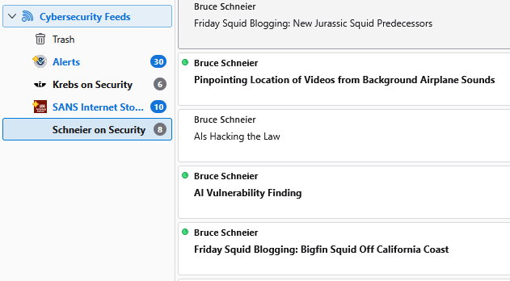

### b) Krebs on Security

I added the required [Krebs on Security](https://krebsonsecurity.com/) feed:
`https://krebsonsecurity.com/feed/`
This blog focuses quite much on cybercrime, investigations, data breaches and real security incidents. I think it is a useful source because it doesn't only describe technical vulnerabilities, but also explains what happens in real life.
The feed was added successfully, and I could see the latest articles in Thunderbird.

### c) Schneier on Security

The second required source was [Schneier on Security](https://www.schneier.com/).
I found its Atom feed:
`https://www.schneier.com/feed/atom/`
Bruce Schneier often writes about security from a wider point of view, including privacy, technology, politics and society.
This is a bit different from reading only technical security news. Sometimes it is useful to think not only about how an attack works, but also about why it happens and what consequences it may have.
The feed worked correctly in Thunderbird.

### d) Two additional cybersecurity feeds

I wanted to choose two sources that would give me something different from Krebs and Schneier. I looked for established security resources and their RSS feeds.

**SANS Internet Storm Center**

Website: https://isc.sans.edu/
Feed: `https://isc.sans.edu/rssfeed_full.xml`
I was already familiar with SANS Internet Storm Center from our earlier cybersecurity assignments, where I listened to Stormcast episodes.
I chose this source because I like practical technical analysis. SANS publishes information about attacks, vulnerabilities, suspicious network traffic and malware. Sometimes the articles include real logs, HTTP requests and other technical details, which are especially interesting for me because of my IT background.
I found the feed on the SANS website and added the full-text RSS version.

**CISA — Cybersecurity Alerts**

Website: https://www.cisa.gov/

Feed: `https://www.cisa.gov/cybersecurity-advisories/alerts.xml`
For the fourth source, I chose CISA, the US Cybersecurity and Infrastructure Security Agency.
I wanted to have also an official security source, not only blogs and technical diaries. CISA publishes cybersecurity alerts and information about vulnerabilities that are known to be exploited.
From my point of view, this is quite useful when thinking about which security problems should be handled first in a real IT environment.
I located the cybersecurity alerts RSS feed and subscribed to it in Thunderbird.
Both additional feeds worked correctly, and now I had four different security sources in one reader.


### e) Following cybersecurity feeds

I started following the four RSS feeds on 8 November 2026 and checked the new publications during the following days.
To make reading more convenient, I created a saved search folder in Thunderbird called `month`. It collects articles from all four feeds that are less than 30 days old. I sorted them by date, with the newest articles first.
This gives me something like a **River of News**, where I can see publications from different sources in one list instead of opening each feed separately.

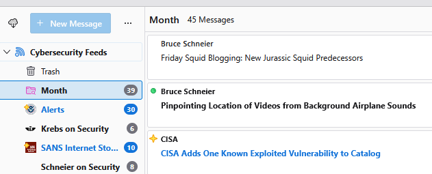

**What I found interesting**

One good example was Microsoft Patch Tuesday in November 2026. Both Krebs on Security and SANS Internet Storm Center covered it, but their articles were quite different.
Krebs explained the situation in a more general way, including the increasing number of vulnerabilities, already exploited problems and what administrators should prioritize.
SANS provided much more technical information, including a long list of CVEs, severity ratings and affected products.
I also noticed that the numbers were different: Krebs mentioned 1,093 vulnerabilities, while SANS reported 1,260. The SANS article included 167 Chromium vulnerabilities affecting Microsoft Edge, which seems to explain the difference in the totals.
This was a good example of why I prefer to follow several sources. Even when they describe the same event, they may count things differently or focus on different details.
Another article I paid attention to was the SANS report about **GPUStack authentication bypass (CVE-2026-102895)**. The vulnerability was caused by trusting the HTTP header `X-Gpustack-Real-IP`. By setting this header to `127.0.0.1`, an external attacker could make a vulnerable server treat the request as local and bypass authentication.
What interested me was that the article included examples of actual suspicious HTTP requests. It is a rather simple technical mistake, but with serious consequences.

I also read a SANS article about the **Macfinger ClickFix campaign and DownTheDRAIN infostealer for macOS**. In this case, users were tricked by a fake CAPTCHA page into executing a command in Terminal, which downloaded malicious software.
This reminded me of the old Trojan attacks I encountered while working at a dial-up ISP. The technologies and targets have changed quite a lot, but stealing information by tricking users is still a very familiar problem.
From Schneier on Security, I found the essay **"AI Doesn't Have to Go Rogue to Break the World"** interesting. Bruce Schneier discusses how AI can exploit weaknesses in systems even without malicious intentions, simply by finding unexpected ways to complete a task.
This article was quite different from the technical reports on SANS, and I think this variety is one of the advantages of following several security sources.

**Advantages and disadvantages of using RSS**

For me, the main advantage is convenience. I can quickly look through many publications in one place, compare different sources and decide which articles I want to read more carefully.
The River of News view is especially useful because I can notice when several sources write about the same event. It also helps me find technical details that I might miss if I read only one blog.
But there are disadvantages as well. Some sources publish much more frequently than others, so the list can become quite noisy. Also, a feed reader does not automatically connect related articles or explain why different sources report different numbers. I still need to compare the information myself.
Compared with browsing websites separately, RSS saves time. Compared with social media, it gives me a more controlled selection of sources without an algorithm deciding what I should see.
I think I will continue using RSS for cybersecurity news, although I probably need to be selective about which articles I read in detail.


### f) Port scanning localhost with Nmap

For this task, I used my Debian 13 virtual machine in VirtualBox, which I had already prepared for previous cybersecurity assignments.

I installed Nmap using APT and checked the installed version:

```bash
nmap --version
```

The installed version was **Nmap 7.95**.

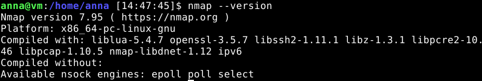

#### Preparing the offline environment

The task required scanning only my own localhost, with the virtual machine disconnected from the internet.
But I also needed to install a new service between two scans. To avoid problems with APT while offline, I first downloaded Apache2 packages without installing them:

```bash
sudo apt install --download-only apache2
```

I checked that the downloaded packages were available in `/var/cache/apt/archives/`.
Before disconnecting the network, I checked the connection:

```bash
ping -c 4 8.8.8.8
```

All four packets received replies, with response times around 2–3 ms.

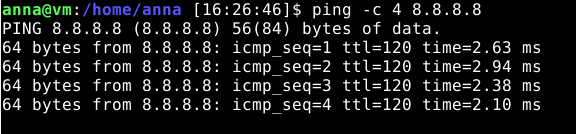

Then I shut down Debian and disabled **Enable Network Adapter** in the VirtualBox network settings.

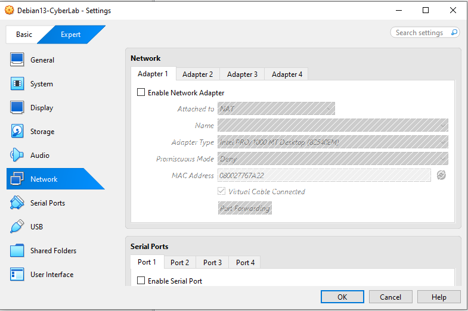

After starting Debian again, I repeated the ping:

```bash
ping -c 4 8.8.8.8
```

This time the result was:

```text
ping: connect: Network is unreachable
```

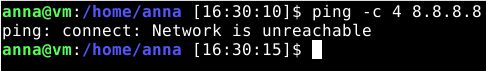

So I confirmed that my VM was offline. The localhost interface still works without an external network connection, so it was possible to continue the experiment safely.

#### First scan — before installing Apache2

I started with the scan suggested in the assignment:

```bash
sudo nmap -A -v localhost
```

It worked, but the verbose output was very long, with information about scan stages and OS detection. For a more readable result, I repeated the scan without `-v`:

```bash
sudo nmap -A localhost
```

Nmap found one open TCP port:

```text
PORT    STATE SERVICE VERSION
631/tcp open  ipp     CUPS 2.4
```

The other 999 scanned TCP ports were closed.

Port 631 belongs to CUPS, the Linux printing system. I didn't expect to find a printing service in my VM, but it was already running. There was no HTTP server listening on port 80.

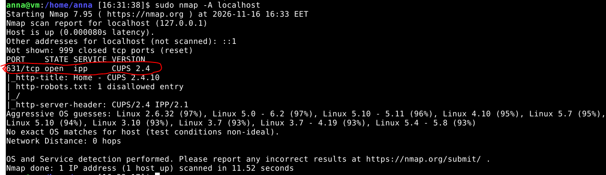

#### Installing Apache2 without internet access

After the first scan, I installed Apache2 from the packages downloaded earlier:

```bash
sudo apt install --no-download apache2
```

The installation finished without errors. Apache2 was started automatically, which I checked with:

```bash
systemctl is-active apache2
```

The result was:

```text
active
```

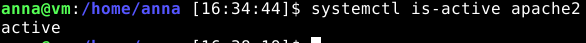

#### Second scan — after installing Apache2

Now I repeated the same scan:

```bash
sudo nmap -A localhost
```

This time Nmap found two open TCP ports:

```text
PORT    STATE SERVICE VERSION
80/tcp  open  http    Apache httpd 2.4.71 ((Debian))
631/tcp open  ipp     CUPS 2.4
```

Nmap also identified the default Apache page:

```text
http-title: Apache2 Debian Default Page: It works
```

Now 998 TCP ports were closed instead of 999.

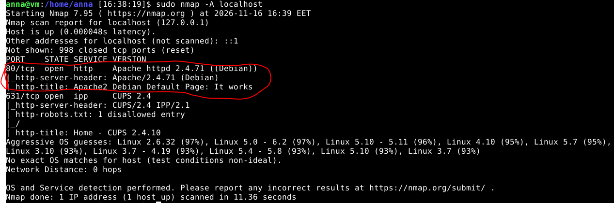

#### Comparing the results

| Before Apache2 | After Apache2 |
|---|---|
| 631/tcp open — CUPS | 631/tcp open — CUPS |
| 80/tcp closed | 80/tcp open — Apache2 |
| 999 closed TCP ports | 998 closed TCP ports |

The difference was quite clear. After installing Apache2, a new service became available on TCP port 80, and Nmap could identify the web server and its version.
One thing I found interesting was that Nmap detected CUPS already during the first scan. It shows that even when I haven't installed any server application myself, there may be some network services running in the system.
Also, I noticed that `-A` gives quite a lot of additional information, including HTTP page titles and server headers. It is useful for investigation, but not always necessary if I only want to see which ports are open.
All scans were performed only against my own `localhost`, while the virtual machine was disconnected from the network.


### g) Bonus: Detecting port scanning in Apache logs

After installing Apache2 and scanning `localhost` with Nmap, I wanted to check if the web server noticed our scanning activity.
I started by checking the Apache access log:

```bash
sudo tail -n 20 /var/log/apache2/access.log
```

I found several HTTP requests from `127.0.0.1`, all recorded on 16 November 2026 at 16:39:53, exactly when I performed the second Nmap scan.
The interesting part was the `User-Agent` field:

```text
Mozilla/5.0 (compatible; Nmap Scripting Engine; https://nmap.org/book/nse.html)
```

So Nmap was not even trying to hide itself. Its scripting engine identified itself directly in the HTTP requests.
I also noticed different requests made by Nmap, for example:

```text
GET /.git/HEAD HTTP/1.1     404
OPTIONS / HTTP/1.1         200
PROPFIND / HTTP/1.1        405
GET /HNAP1 HTTP/1.1        404
```

These requests were part of Nmap's additional service checks. For example, `/.git/HEAD` is a request for a Git metadata file, and `OPTIONS` checks supported HTTP methods.
To see only requests explicitly identifying Nmap, I used:

```bash
sudo grep 'Nmap Scripting Engine' /var/log/apache2/access.log | tail -n 8
```

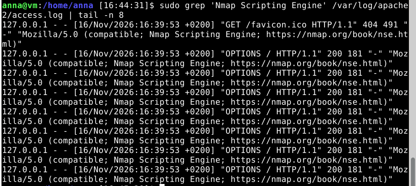

For me, this was a good practical example of how application logs can help to notice scanning activity. In this case, detection was quite easy because Nmap included its name in the HTTP `User-Agent`.
However, Apache access logs contain HTTP requests, not all network packets. This means that a different type of port scan might not appear in these logs.
I decided to test exactly this in the next bonus task.

### h) Bonus: Scanning without detection by the previous method

In the previous task, I detected Nmap by looking for HTTP requests in Apache's `access.log`, especially the `Nmap Scripting Engine` user agent.
Now I wanted to check if I could still identify an open port without generating these HTTP requests.
First, I checked the number of entries in the access log:

```bash
sudo wc -l /var/log/apache2/access.log
```

The result was:

```text
29 /var/log/apache2/access.log
```

Then I performed a TCP SYN scan of port 80 on my own localhost:

```bash
sudo nmap -sS -p 80 localhost
```

The result was:

```text
Starting Nmap 7.95 ( https://nmap.org ) at 2026-11-16 16:47 EET
Nmap scan report for localhost (127.0.0.1)
Host is up (0.000052s latency).

PORT   STATE SERVICE
80/tcp open  http

Nmap done: 1 IP address (1 host up) scanned in 0.09 seconds
```

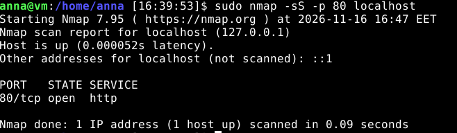

Nmap successfully identified port 80 as open.

Unlike the earlier `-A` scan, this command did not run HTTP NSE scripts or perform service version detection. A SYN scan determines whether the TCP port is open without completing a normal TCP connection and sending an HTTP request.

After the scan, I checked the Apache access log again:

```bash
sudo wc -l /var/log/apache2/access.log
```

The result was still:

```text
29 /var/log/apache2/access.log
```

So the number of log entries did not change. The SYN scan found the open port, but it did not generate any new entries in Apache's access log.
This means my detection method from task g did not notice the new scan.
Of course, this doesn't mean that a SYN scan is completely invisible. A firewall, IDS or network monitoring system could still detect the TCP packets. But Apache's HTTP access log was not enough to detect this particular scan.
I think this was the most interesting part of the Nmap experiment. In task g, detecting the scan was very easy because Nmap identified itself in HTTP requests. But just changing the scanning method was enough to avoid that specific detection method.
Both experiments were performed only against my own `localhost`, with the Debian virtual machine disconnected from the network.

