## x) Read and summarize

### Schneier (2015): Applied Cryptography

**Chapter 1.1 – Terminology**

- Encryption means that we change plaintext to ciphertext, and decryption makes it again readable. Cryptography is not only about secrecy, it is used also for authentication, integrity and nonrepudiation.
- In modern cryptography the secret is the key, not the algorithm. Attacker can know how algorithm works, but without the key he still can't read the data.
- **Symmetric encryption** uses one same key for both sides. This means they must somehow share the key before they start to communicate.
- **Public-key encryption** has two keys. Public key is for encrypting and everybody can get it, private key is for decrypting and the owner keeps it only for himself.

**Chapter 2.5 – Communications Using Public-Key Cryptography**

- Alice encrypts the message with Bob's public key, and only Bob can open it with his private key. This is the solution for the biggest problem of symmetric crypto: how to send the secret key safely.
- But there is one problem, public-key algorithms are much slower than symmetric. That is why in real life people use both together, it is called **hybrid cryptosystem**. First a random session key is encrypted with public key, and then the message itself is encrypted by this session key with fast symmetric algorithm.

### Karvinen (2023): PGP – Send Encrypted and Signed Message – gpg

Karvinen shows in his article how to send encrypted and signed message with GPG in Linux.

- Both persons make own key pair and exchange the public keys. After that they check the fingerprints, so they can be sure that the key really belongs to the right person.
- Alice encrypts the message with recipient's public key (`--encrypt --recipient`) and signs it with her private key (`--sign`).
- The recipient decrypts the message with his private key (`--decrypt`). GPG checks also the signature with Alice's public key and tells if it is good.

For me the main point was that encryption and signing are two different things. Encryption keeps the message private, and signature shows who sent it and that nobody changed the message. Checking the fingerprint is also important, because otherwise you can encrypt the message to wrong person's key and not notice it.

**Sources:**
- Schneier, B. (2015). [Applied Cryptography](https://learning.oreilly.com/library/view/applied-cryptography-protocols/9781119096726/), sections 1.1 and 2.5.
- Karvinen, T. (2023). [PGP – Send Encrypted and Signed Message – gpg](https://terokarvinen.com/2023/pgp-encrypt-sign-verify/).

## a) Pubkey today

Yesterday I checked my email in the browser. It is a normal everyday example of public-key cryptography, because the connection uses HTTPS.

In a typical TLS 1.3 connection:

- **Certificate Authority (CA):** CA signs the server's certificate with its own private key. The browser already has the public keys of trusted CAs, so it can check this signature.
- **Server:** Sends its certificate, where is the server's public key. With the private key it signs a part of the TLS handshake, and in this way it proves that it is really the right server.
- **Browser:** Checks the certificate chain against trusted CAs and verifies the server's signature with the public key from the certificate.
- **Key exchange:** Browser and server send each other temporary public key values (using (EC)DHE). Each side has its own temporary private key, and with it they count the same shared secret, without sending it over the network.
- **Communication:** Both sides make symmetric keys from this shared secret. These keys protect the real HTTPS traffic.

So public-key cryptography is used to build a trusted and encrypted connection, and after that symmetric encryption does the work with the data.

**Sources:**
- [RFC 8446 – TLS 1.3](https://www.rfc-editor.org/rfc/rfc8446.html)
- [Cloudflare – What Happens in a TLS Handshake?](https://www.cloudflare.com/learning/ssl/what-happens-in-a-tls-handshake/)

## b) Encrypt and decrypt a message

I used GnuPG 2.4.7 on my Debian 13 VM. I simulated two users, Alice and Bob, with separate GPG directories, like in Karvinen's tutorial.

First I checked the GPG version and made two directories with permissions `700`, so only my Linux user can open them.

```bash
gpg --version
mkdir -p ~/h5/alice ~/h5/bob
chmod 700 ~/h5/alice ~/h5/bob
```

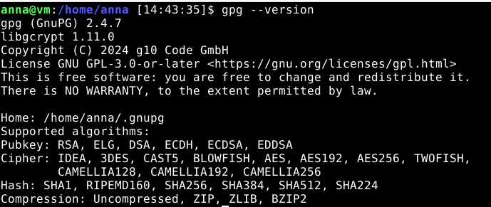

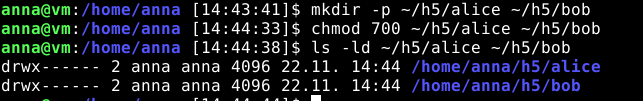

### Generating and exchanging keys

I made key pairs for Alice and Bob with `gpg --homedir ... --gen-key`. Each user got Ed25519 primary key for signing and certification `[SC]` and Curve25519 subkey for encryption `[E]`. I left the passphrases empty, like in Karvinen's demo.

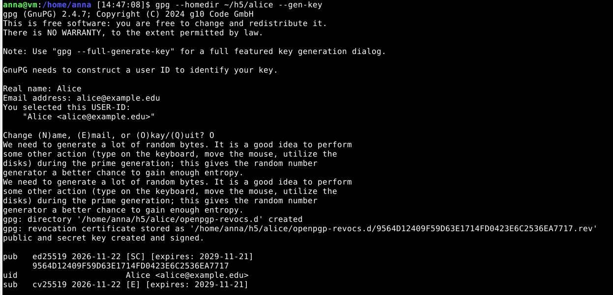

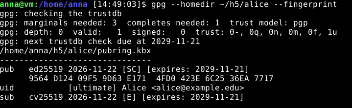

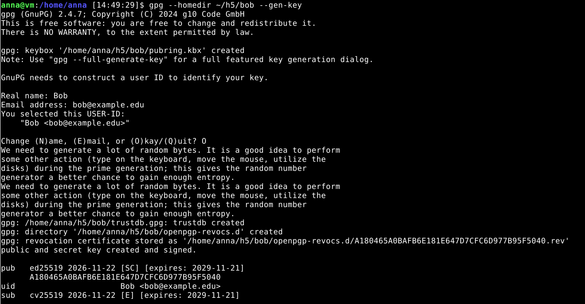

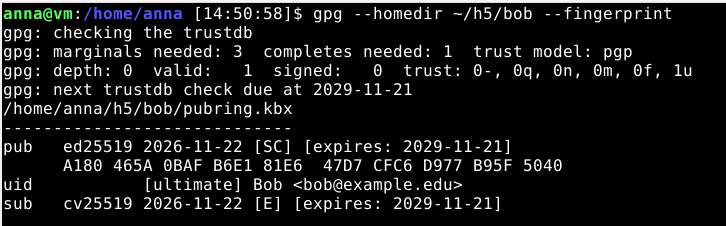

Then I exported the public keys and imported them to each other's keyrings.

```bash
gpg --homedir ~/h5/alice --armor --export alice@example.edu > ~/h5/alice.pub
gpg --homedir ~/h5/bob --armor --export bob@example.edu > ~/h5/bob.pub

gpg --homedir ~/h5/alice --import ~/h5/bob.pub
gpg --homedir ~/h5/bob --import ~/h5/alice.pub
```

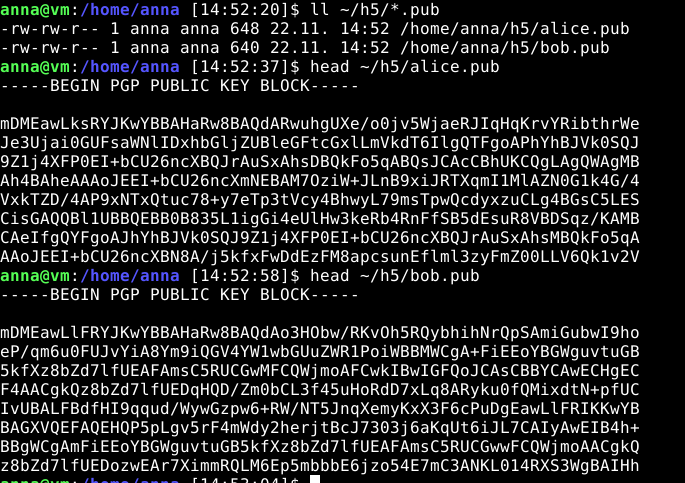

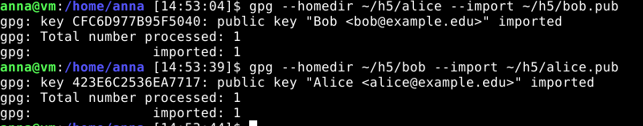

Both imported keys had `[unknown]` trust at first. I compared the fingerprints with the originals and signed the keys with `--sign-key`. After that GPG showed `[full]` for both.

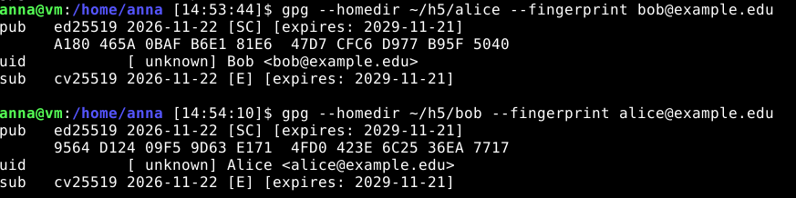

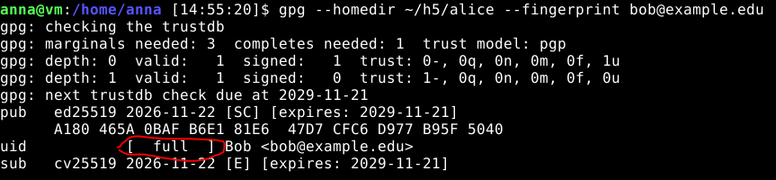

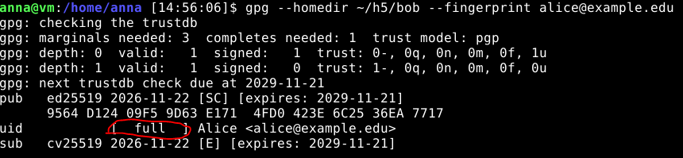

### Encrypting and decrypting

I wrote a short message from Alice to Bob:

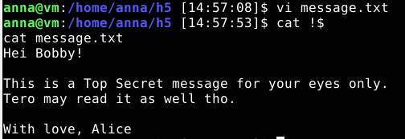

Alice encrypted it with Bob's public key and signed it with her own private key.

```bash
gpg --homedir ~/h5/alice --encrypt \
  --recipient bob@example.edu \
  --sign --local-user alice@example.edu \
  --armor --output ~/h5/encrypted.asc ~/h5/message.txt
```

The result file was an ASCII-armored PGP message, it starts with `-----BEGIN PGP MESSAGE-----`. The plaintext was not readable anymore.

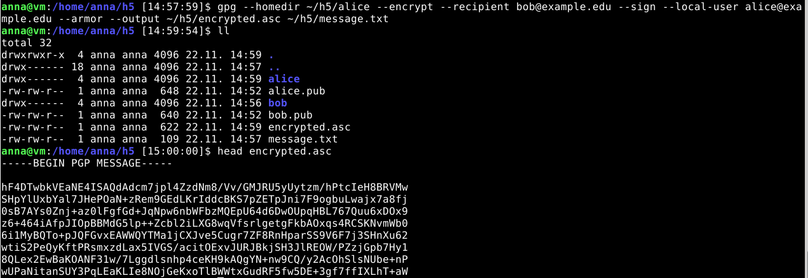

Bob decrypted it with his private key:

```bash
gpg --homedir ~/h5/bob --decrypt ~/h5/encrypted.asc
```

GPG showed the original message and this line:

`Good signature from "Alice <alice@example.edu>" [full]`

It means that the signature was valid and Alice's public key is trusted in Bob's keyring.

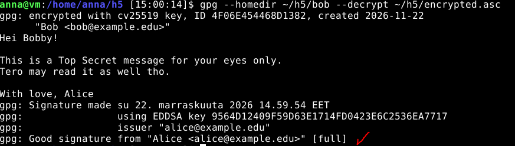

I also saved the decrypted text to a file and compared it with the original by `diff`. In my first try I used a pipe, and `diff` tried to open the file before GPG finished writing it. When I ran the commands one after another, it worked.

```bash
gpg --homedir ~/h5/bob --output ~/h5/decrypted.txt --decrypt ~/h5/encrypted.asc
diff ~/h5/message.txt ~/h5/decrypted.txt
echo "diff exit code: $?"
```

The result was `diff exit code: 0`, so the decrypted message is the same as the original.

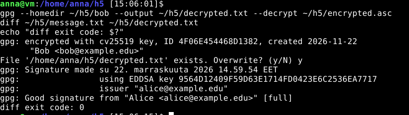

### Security evaluation

GPG is a well-known open-source tool, and in this test it used modern Ed25519 and Curve25519 keys.

- **Confidentiality:** Only Bob's private encryption key can decrypt the message.
- **Integrity and authentication:** Thanks to Alice's signature, Bob can check who sent the message and see if somebody changed it.
- **Key verification:** Checking the fingerprints is important, because otherwise an attacker can replace the public key.
- **Private key protection:** I used empty passphrases only for this isolated test. For real keys it would be unsafe.

I also tried to decrypt the message in Alice's keyring:

```bash
gpg --homedir ~/h5/alice --decrypt ~/h5/encrypted.asc
```

GPG answered `decryption failed: No secret key`. Alice could encrypt the message for Bob, but she can't decrypt it, because she doesn't have Bob's private key.

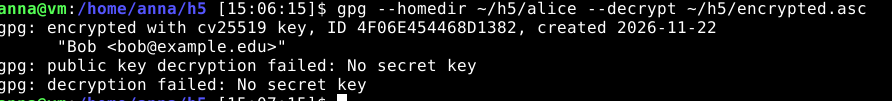

## d) Voluntary: Details of PGP

I did this voluntary task together with part b. Alice and Bob had separate GPG keyrings, they exchanged and verified the public keys, and Alice sent Bob an encrypted and signed message.

The important options were:

- `--homedir` — chooses the keyring of the right user.
- `--encrypt --recipient` — encrypts the message for Bob with his public encryption key.
- `--sign --local-user` — signs the message with Alice's private signing key.
- `--armor` — makes the message as ASCII text, so it is easy to copy.
- `--decrypt` — decrypts the message and checks the signature.

This test showed the difference between encryption and signing. Encryption stops someone like Eve from reading the message. Signing helps Bob to notice changes or impersonation by someone like Mallory, but only if Alice's signing key is authentic and stays secret.

**Sources:**
- [Karvinen, T. (2023). PGP – Send Encrypted and Signed Message – gpg](https://terokarvinen.com/2023/pgp-encrypt-sign-verify/)
- [GnuPG Manual](https://gnupg.org/documentation/manuals/gnupg/)
- [Karvinen – H5 Alice and Bob](https://terokarvinen.com/cyber-security/)


## c) Password management

I used KeePassXC 2.7.10 on my Debian 13 VM to try a password manager in practice.

First I installed KeePassXC and made a test database **H5 Password Manager Demo**. I protected it with a master password.


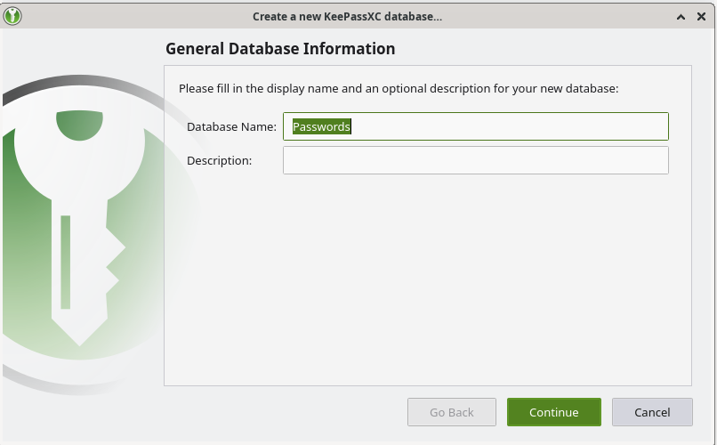

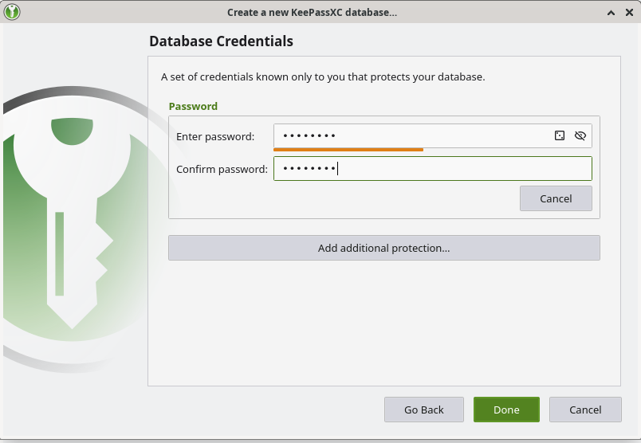

Then I made a test entry for `alice@example.edu` with a website URL and some notes. I didn't invent the password by myself, but used the built-in generator. It made a random 20-character password with uppercase and lowercase letters, numbers and special characters. KeePassXC showed quality **Excellent** and entropy 116.81 bits.

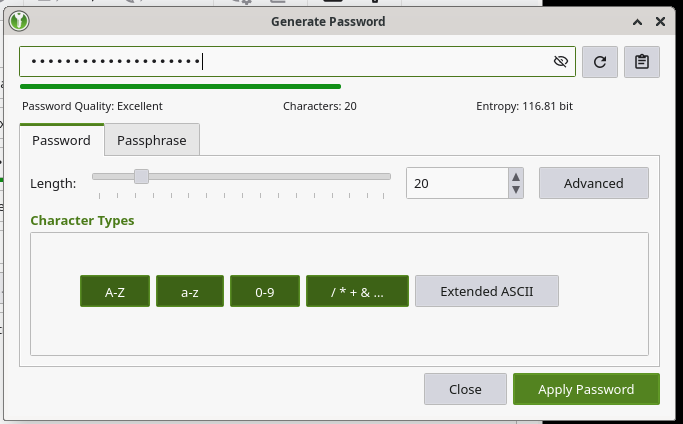

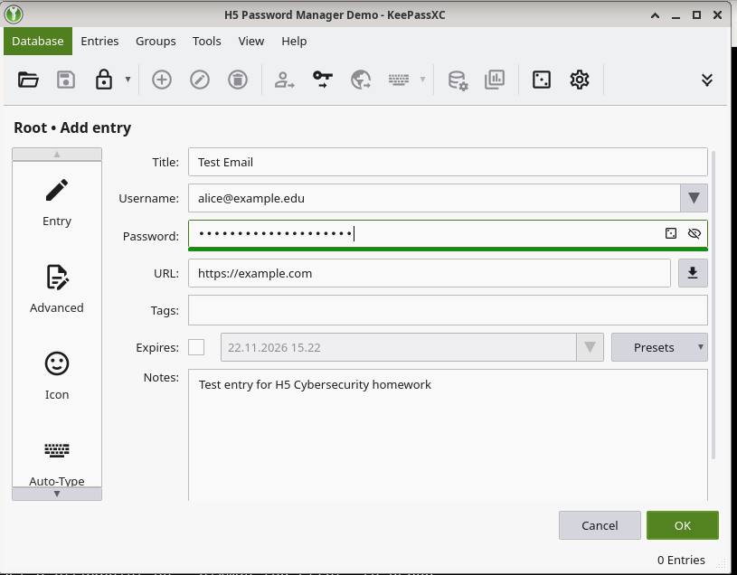

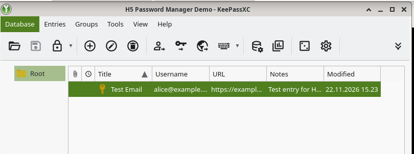

I also tested locking the database. To open it again KeePassXC asked the master password, and after that I could see the saved entry.

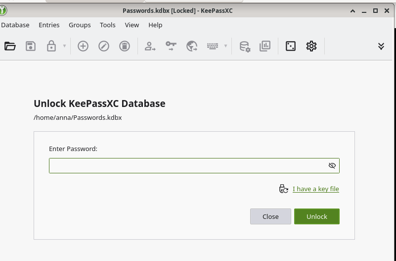

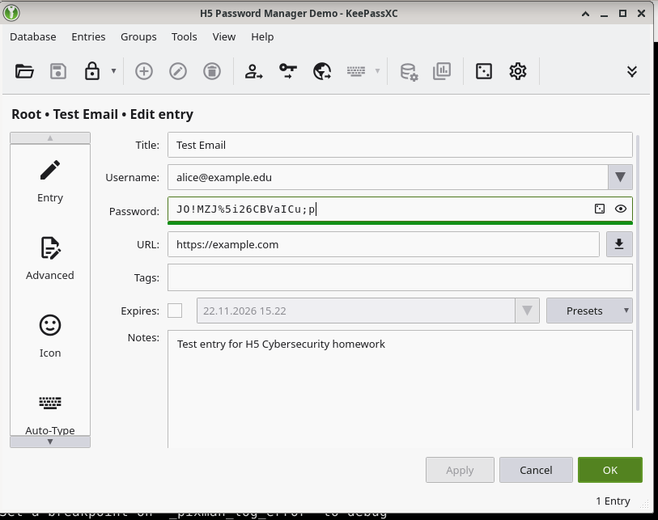

### Security considerations

A password manager helps against several common problems:

- **Password reuse:** Without a manager people often use the same password in many places. If one service is hacked, attackers try the same login on other sites (credential stuffing).
- **Weak passwords:** People choose passwords which are easy to remember, so they are also easy to guess. This makes dictionary attacks much easier.
- **Phishing:** Password manager with URL matching and browser integration can help to notice a fake website, because it will not fill the password on the wrong address. But it doesn't remove the risk completely.

KeePassXC keeps the passwords in an encrypted local database, so I need to remember only one master password instead of many.

But this also makes the master password very important. If it is weak or somebody steals it, the whole database is in danger. Another risk is to lose the database without a backup.

In my opinion, a password manager is much more practical than trying to remember dozens of strong passwords, especially when you work with many IT systems and accounts.

**Sources:**
- [KeePassXC – Official Website](https://keepassxc.org/)
- [KeePassXC User Guide](https://keepassxc.org/docs/KeePassXC_UserGuide)
