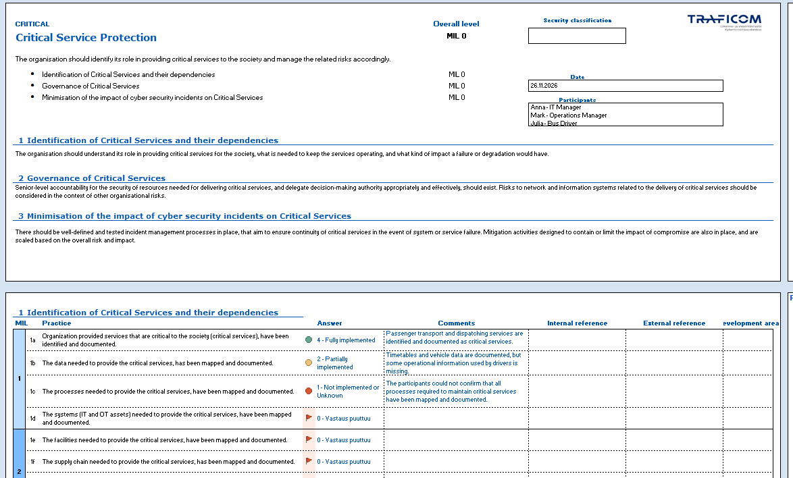

# h6 Mature

## x) Read and summarize

### Traficom: Cybermeter User Guide

**Summary and checklist of the assessment process (p. 10)**

The assessment goes in five steps:

- **Initiate:** management decides what to assess and appoints a sponsor and a facilitator.
- **Prepare:** define the scope and critical dependencies, invite the right specialists and agree on the method and schedule.
- **Conduct:** go through the practices together using the self-assessment tool.
- **Identify development activities:** analyse the results, set a target level and decide what to fix first.
- **Perform activities and update assessment:** do the improvements, update the assessment and reassess when needed.

Key idea: it's a loop, not a one-off form, and it shouldn't be done by one security person alone.

**Cybermeter maturity model (pp. 11–14)**

- **Level 0:** basic requirements are not met.
- **Level 1:** basics are met, but mostly ad hoc.
- **Level 2:** documented processes, defined roles, enough resources and skills.
- **Level 3:** guided by policies, performance is monitored and processes keep improving.

The model has 11 domains and 52 objectives. Each practice is rated as not, partly, mostly or completely implemented, and only "mostly" and "completely" count as implemented.

- MIL 1 needs all Level 1 practices.
- MIL 2 needs all Level 1 practices and more than half of Level 2 practices.
- MIL 3 needs all Level 1 and 2 practices and more than half of Level 3 practices.

This is a bit lighter than the original C2M2, which requires all practices on each level. The weakest objective sets the level of the whole domain, so fancy tools in one area won't help if the basics are missing. A giant fence with the door open.

**Cybermeter maturity report (p. 23)**

- Shows a maturity level (0–3) for each of the 11 domains, a graph per domain and the level of each objective.
- Meant for cybersecurity and risk management professionals and other technically responsible people.
- NCSC-FI can also provide anonymised comparison data from other organisations.

For me the most useful part is that it shows where to focus. It's tempting to polish areas that are already strong, but that makes little sense if another important area still has basic problems.

### Traficom: Kybermittari spreadsheet

Kybermittari is a free Excel file that works offline, with one worksheet per domain. You rate the practices, and the spreadsheet calculates the maturity levels and builds the report. There's also a NISTmap tab that maps the practices to the NIST Cybersecurity Framework.

I opened the spreadsheet, switched to English and explored the CRITICAL domain. Each practice has columns for the answer, comments and references. I used this worksheet for the exercise below.

Its weakness: it only knows what you tell it. If people guess or are too optimistic, the report looks professional but says nothing about reality.

## a) Make-belief analysis

Fictional company: **Helsinki City Bus Services**. Participants:

- **Anna** – IT Manager
- **Mark** – Operations Manager
- **Julia** – Bus Driver

We assessed three practices from the **Critical Service Protection** domain, under *Identification of Critical Services and their dependencies*.

### 1a – Critical services identified and documented

**Anna:** "Passenger transport and dispatching are on our critical services list."

**Mark:** "What about ticket sales?"

**Anna:** "Left out on purpose. If it fails, people ride free for a day, but the buses still run."

**Julia:** "Dispatching is the one I really need. Without it I'm driving blind."

→ **4 – Fully implemented**

### 1b – Data needed for critical services mapped

**Anna:** "Timetables and vehicle data are documented."

**Julia:** "I also get detour info from another system, and sometimes from a WhatsApp group."

**Anna:** "...WhatsApp? That's not on any of my lists."

→ **2 – Partially implemented**

### 1c – Processes needed for critical services mapped

**Mark:** "We have procedures for normal days."

**Anna:** "But what about when something breaks?"

**Julia:** "We call dispatching. Then it depends on who answers."

**Mark:** "So it's all in people's heads."

→ **1 – Not implemented or Unknown**

### Assessment results

*Figure 1. Three practices assessed in the CRITICAL domain of the Kybermittari spreadsheet.*

The spreadsheet gave the domain **MIL 0**. Even though 1a was fully implemented, 1b and 1c kept the domain from reaching even Level 1, which is the "weakest link" rule in practice. Only three practices were assessed, so this is not a full maturity assessment of the fictional company.

### My observations

IT didn't know about the WhatsApp group. If Anna had filled in the sheet alone, 1b would probably have been marked fully implemented. IT knows the systems, operations knows the business, and drivers know how things really work. You need all of them in the room to get a realistic result.

## b) Sucks or succeeds

**Useless:** when the only goal is a nice report for management. The IT manager fills in the sheet alone, gives everything high scores and asks no one. It looks great on paper, but nobody knows what really happens day to day. Then the report gets forgotten, and the whole thing was a waste of time.

**Useful:** when people from different departments take part and are honest about problems, like the WhatsApp discovery in my bus story. Discussions like that reveal things management never knew. But the assessment alone isn't enough: someone has to decide what to fix, who does it, and check back later.

In the end, Kybermittari is just an Excel file. It doesn't make anyone more secure by itself. What matters is what people do with it.

## c) Competition

Instead of the obvious NIST CSF or ISO 27001, I looked at two less common alternatives.

### 1. C2M2 (Cybersecurity Capability Maturity Model)

The US Department of Energy model that Kybermittari is built on, with the same idea of domains, practices and maturity levels. Version 2.1 has over 350 practices in 10 domains.

- **Plus:** free, used internationally and comes with ready self-evaluation tools, so results are easier to compare with foreign partners.
- **Minus:** developed with the US energy sector in mind. It lacks Kybermittari's critical services domain and Finnish comparison data, and its level rules are stricter.

### 2. CIS Controls v8.1

A prioritised list of 18 controls and 153 concrete safeguards, split into three implementation groups. IG1 is "basic cyber hygiene", a sensible minimum for small companies.

- **Plus:** very practical, it tells you exactly what to do, like keeping a device inventory or using MFA.
- **Minus:** mostly technical. It doesn't make IT, operations and management sit down together the way Kybermittari does.

### My comparison

Kybermittari shows where you are and starts the discussion. CIS Controls helps decide what to do next on the technical side. ISO 27001 is the choice if you need certification, and NIST CSF is a flexible general framework. They don't really compete; they work well together.

## References

1. Traficom / NCSC-FI. *Cybermeter – User Guide, Version 1.*  
   https://terokarvinen.com/kybermittari/files/Kybermittari_Cybermeter_User_Guide_V1.pdf

2. Traficom / NCSC-FI. *Kybermittari self-assessment tool, v2.1.*  
   https://terokarvinen.com/kybermittari/files/Kybermittarin%20arviointity%C3%B6kalu_v2.1_20230829.xlsx

3. Karvinen, T. *Kybermittari – Traficom security maturity spreadsheet.*  
   https://terokarvinen.com/kybermittari/

4. NCSC-FI. *Kybermittari.*  
   https://kyberturvallisuuskeskus.fi/en/our-services/situation-awareness-and-network-management/kybermittari

5. U.S. Department of Energy. *Cybersecurity Capability Maturity Model (C2M2).*  
   https://www.energy.gov/c2m2

6. Center for Internet Security. *CIS Critical Security Controls v8.1.*  
   https://www.cisecurity.org/controls/v8-1
